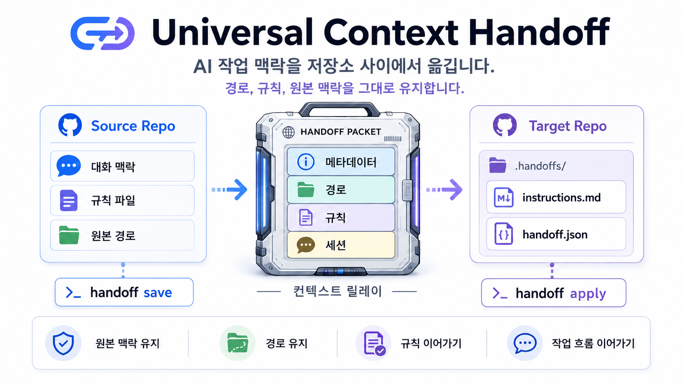

[English](./README.md) | [한국어](./README-ko.md)

# Universal Context Handoff Skill



## 개요

`universal-context-handoff`는 한 저장소의 AI Assistant(Claude Code, Codex, Antigravity 등) 대화 맥락을 다른 저장소로 넘길 때, 원본 저장소 경로와 대상 저장소 경로, 원래 사용하던 규칙 파일(CLAUDE.md, AGENTS.md, .cursorrules) 정보, 그리고 선택적인 설정/스킬 복사 결과를 함께 보존하는 오픈소스 CLI 및 스킬 프로젝트입니다.

## 왜 유용한가

여러 저장소를 오가며 작업할 때 AI 어시스턴트는 이전 대화에서 언급된 상대 경로와 규칙이 어느 저장소 기준인지 잃어버리기 쉽습니다. 이 프로젝트는 handoff 메타데이터와 명시적인 instruction block을 생성해서 다음 저장소에서도 대화 출처와 경로 해석 기준을 유지하게 합니다.

## 추출 엔진

기본 extractor는 이 저장소 안에 내장되어 있고, MIT 라이선스인 [`claude-conversation-extractor`](https://github.com/ZeroSumQuant/claude-conversation-extractor) 프로젝트의 JSONL 파싱 로직을 바탕으로 옮겨 왔습니다. 기본적으로 `~/.claude/projects`, `~/.codex/sessions`, `~/.gemini/antigravity/brain` 등 각 플랫폼의 대화 저장소를 직접 읽습니다.

다른 워크플로우가 필요하면 `HANDOFF_EXTRACTOR_MODE=external`과 `HANDOFF_EXTRACTOR_BIN`을 사용해 외부 extractor 바이너리로 전환할 수 있습니다.

## 설치 및 준비

글로벌 터미널 명령어로 `handoff` 도구를 사용하려면, 이 저장소를 클론해 빌드하고 링크를 등록합니다:

```bash
pnpm install
pnpm build
pnpm link --global
```

이제 `handoff` 명령어를 터미널 어디에서나 사용할 수 있습니다.

## 사용 방법: 소스 저장소에서 handoff 저장

```bash
handoff save --source /path/to/source-repo --platform antigravity
```

이 명령은 대화 목록을 보여 주고, 선택한 세션의 transcript와 메타데이터를 `~/.context-handoffs/handoffs/<handoff-id>/` 아래에 저장합니다.

## 사용 방법: 타깃 레포에서 바로 시작

```bash
handoff start --source /path/to/source-repo --target /path/to/target-repo
```

이 명령은 handoff를 저장하고 타깃 레포에 적용한 뒤, 타깃 저장소에서 어시스턴트 세션을 즉시 실행하여 handoff 메타데이터 파일을 먼저 로드하고 작업을 이어가도록 유도합니다.

## 사용 방법: 타깃 저장소에서 handoff 적용

```bash
handoff apply --target /path/to/target-repo
```

이 명령은 저장된 handoff를 고르게 하고, 어시스턴트가 새 대화에서 읽을 수 있는 JSON payload와 Markdown instruction 파일을 타깃 저장소의 `.handoffs/`에 기록합니다.

## 설정/스킬 복사 옵션

지원 모드는 `none`, `skills`, `config`, `mcp`, `all`입니다.

- `skills`: `.claude/skills` 등의 플러그인/스킬 디렉토리
- `config`: `.claude/config.*`, `.claude/settings.*` 등 설정
- `mcp`: `.claude/mcp*` 등 MCP 구성

충돌이 있으면 `skip`, `overwrite`, `rename` 전략을 선택합니다. `rename`은 `-from-source` 접미사를 붙입니다. 명백한 절대 경로는 타깃 저장소 기준으로 치환하고, 애매한 경로는 메타데이터 경고로 남깁니다.

## 주의할 점

- 내장 extractor가 프로젝트 폴더를 찾지 못하면 `HANDOFF_PROJECTS_DIR`을 지정하거나 외부 모드로 전환해야 합니다.
- 원본 저장소에 규칙 설정 파일(CLAUDE.md, AGENTS.md, .cursorrules)이 없으면 해당 필드는 `null`로 기록됩니다.
- 손상된 handoff 메타데이터는 검증 단계에서 에러로 중단됩니다.
