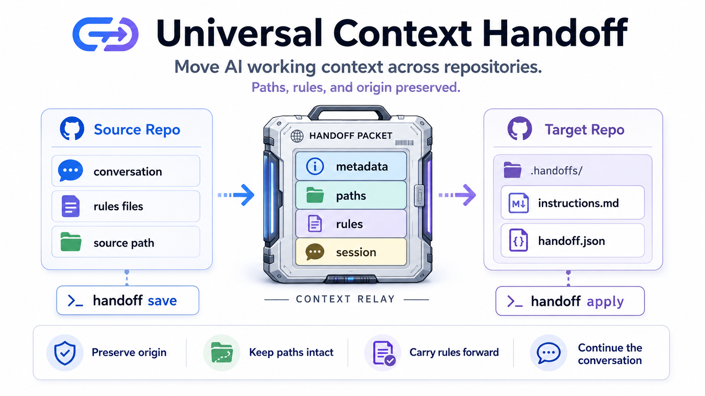

[English](./README.md) | [한국어](./README-ko.md)

# Universal Context Handoff Skill



## Overview

`universal-context-handoff` is an open-source CLI and skill for moving AI Assistant (Claude Code, Codex, Antigravity, etc.) conversation context from one repository to another while preserving the source repo path, target repo path, original rules files, and optional transfer results.

## Current support boundary (v0.1.0)

- **Supported:** Claude Code JSONL sessions, Codex CLI rollout JSONL sessions, and Codex archived sessions.
- **Experimental:** Antigravity legacy JSONL transcripts.
- **Not supported:** Antigravity IDE `.db` / `.pb` session formats and Claude Cowork. Claude.ai web transcripts need manual import.
- **Privacy:** Local-first handoff. Automatic redaction is best-effort; review generated transcripts and metadata before sharing or committing them.

This is a context-transfer tool, not a cloud-memory service or an autonomous agent runner.

## Why it is useful

When work moves across repositories, AI assistants can lose track of which repository a relative path or convention originally referred to. This project generates durable handoff metadata plus an explicit instruction block in the target's `.handoffs/` directory so future conversations can retain origin and path-mapping context.

## Extraction engine

The default extractor is built into this repository and is adapted from the MIT-licensed [`claude-conversation-extractor`](https://github.com/ZeroSumQuant/claude-conversation-extractor) project. It reads conversation JSONL sessions directly from assistant directories (e.g. `~/.claude/projects`, `~/.codex/sessions`, `~/.gemini/antigravity/brain`).

You can still switch to an external extractor binary through `HANDOFF_EXTRACTOR_MODE=external` and `HANDOFF_EXTRACTOR_BIN` if you need compatibility with another workflow.

## Installation

For global terminal usage, clone this repository and link it:

```bash
pnpm install
pnpm build
pnpm link --global
```

Now you can use the `handoff` command directly.

## Usage: save a handoff from the source repo

```bash
handoff save --source /path/to/source-repo --platform antigravity
```

This command shows available conversations and stores the selected session transcript plus metadata under `~/.context-handoffs/handoffs/<handoff-id>/`.

## Usage: start the assistant directly in the target repo

```bash
handoff start --source /path/to/source-repo --target /path/to/target-repo
```

This command saves a handoff, applies it in the target repo, and launches the session in the target repository with the handoff metadata loaded first.

## Usage: apply a handoff in the target repo

```bash
handoff apply --target /path/to/target-repo
```

This command lets you choose a saved handoff and writes a JSON payload plus Markdown instruction file to `.handoffs/` inside the target repository.

## Configuration transfer options

Supported modes are `none`, `skills`, `config`, `mcp`, and `all`.

- `skills`: `.claude/skills`
- `config`: `.claude/config.*`, `.claude/settings.*`
- `mcp`: `.claude/mcp*`

When conflicts exist, choose `skip`, `overwrite`, or `rename`. The `rename` strategy adds a `-from-source` suffix. Obvious absolute paths are rewritten for the target repository; ambiguous paths are recorded as warnings in metadata for manual review.

## Watch-outs

- If the built-in extractor cannot find target projects dir, set `HANDOFF_PROJECTS_DIR` or switch to external mode.
- If the source repository has no rules files (CLAUDE.md, AGENTS.md, .cursorrules), the field is stored as `null`.
- Corrupted handoff metadata stops execution during schema validation.
